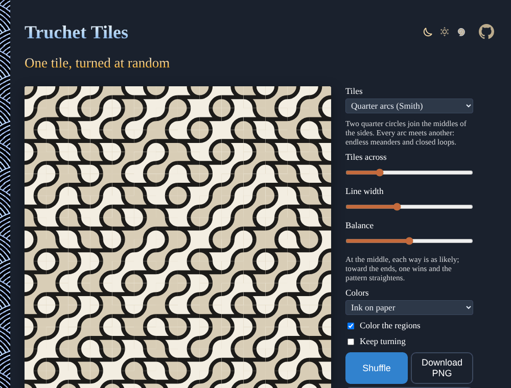

# Truchet-Tiles

One tile, turned at random: lay Sébastien Truchet's half-colored squares, Cyril Stanley Smith's quarter arcs, the diagonals of 10 PRINT, a woven ribbon or hexagonal arcs, and watch them weave into mazes, meanders and closed loops. Click any tile to turn it, and download the pattern as PNG or SVG. No sign-up and no libraries.

- [Lay some tiles](https://evoluteur.github.io/truchet-tiles/)

## What it does

- **Tiles**: Quarter arcs (Smith), Triangles (Truchet), Diagonals (10 PRINT), Weave (arcs and over-under crossings) and Hexagonal arcs.
- **Tiles across** (4 to 48), **Line width**, and **Balance**: at the middle each orientation is as likely; toward the ends one wins and the pattern straightens into waves and diagonals.
- **Colors**, and **Color the regions**: the regions between the arcs take two colors, consistently across the whole pattern.
- **Click a tile** to turn it, with a little animation, or tick **Keep turning** to let the pattern shift by itself. **Shuffle** for a new one.
- **Download PNG**, or **SVG** (for the square arc, triangle and diagonal tiles). The address of the page keeps the pattern (its seed), to share it.

## How it is built

Each tile's orientation comes from a seeded random generator, so the same seed always gives the same pattern. The tiles are drawn one by one on a canvas, each scaled to a unit square and rotated, and clipped a hair larger than the tile so no seams show.

The two-coloring of the arc tiles uses the corners of the grid: each region between the arcs holds the corners of one checkerboard color only, so a region takes the color of the corners it holds, and the colors match from tile to tile. The hexagonal tiles work the same way, with the two classes of corners of a honeycomb.

Plain HTML, CSS and JavaScript, with no dependencies and no build step. Just open `index.html`. The three color themes (dark, light and blue) are shared with my other projects (copied from [omg-themes](https://github.com/evoluteur/omg-themes)).

## A little history

Sébastien Truchet (1657–1729), a Dominican priest and engineer, published *Mémoire sur les combinaisons* in 1704, the first study of tiling patterns by combinations. The patterns were rediscovered by the metallurgist and historian of science Cyril Stanley Smith, who introduced the quarter-arc tiles in *The Tiling Patterns of Sebastien Truchet and the Topology of Structural Hierarchy* (Leonardo, 1987). The one-line maze program inspired the book *10 PRINT CHR$(205.5+RND(1)); : GOTO 10* (MIT Press, 2012), by ten authors.

Truchet-Tiles is open source at [GitHub](https://github.com/evoluteur/truchet-tiles) with MIT license.

Had fun browsing the app? [Buy me a coffee by becoming a sponsor](https://github.com/sponsors/evoluteur).

You may also be interested in my other projects [Maze-Maker](https://github.com/evoluteur/maze-maker) ([demo](https://evoluteur.github.io/maze-maker/)), [Islamic-Patterns](https://github.com/evoluteur/islamic-patterns) ([demo](https://evoluteur.github.io/islamic-patterns/)) and [Kolam-Maker](https://github.com/evoluteur/kolam-maker) ([demo](https://evoluteur.github.io/kolam-maker/)). See them all on [Generative Art](https://evoluteur.github.io/generative-art.html).

Copyright (c) 2026 [Olivier Giulieri](https://evoluteur.github.io/).
